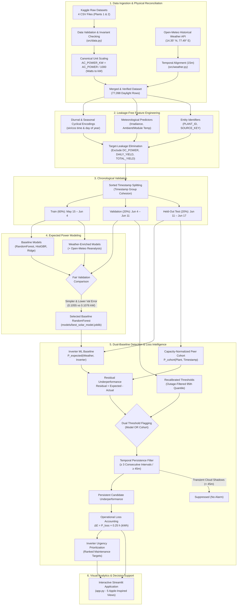
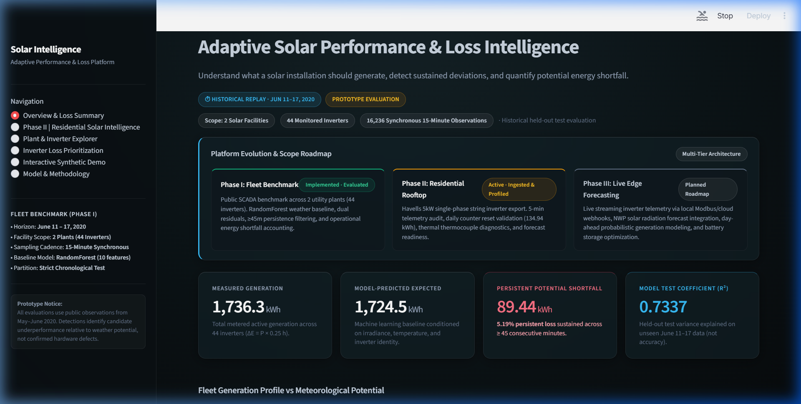
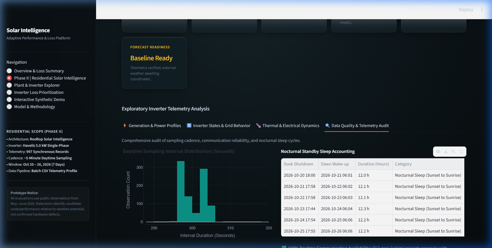
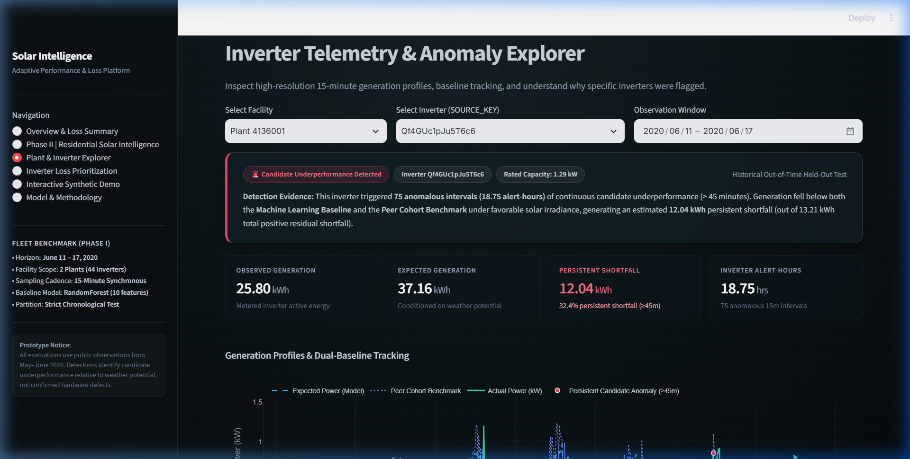
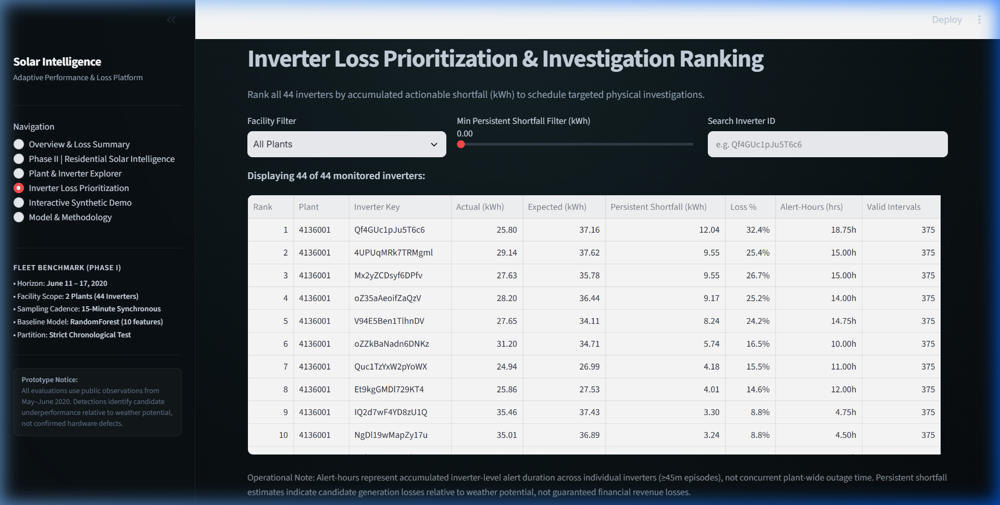
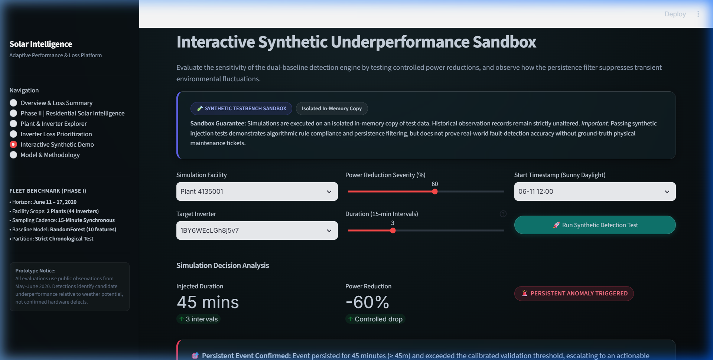
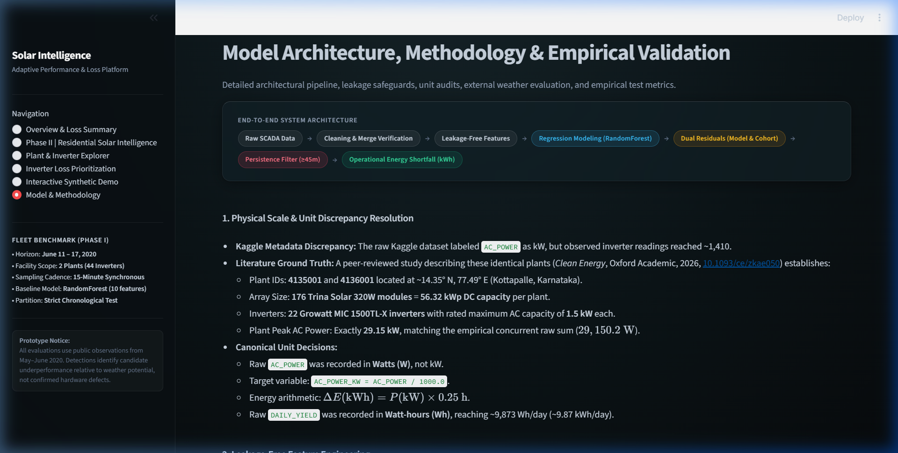

# Adaptive Solar Performance & Loss Intelligence

[](https://www.python.org/downloads/)
[](https://opensource.org/licenses/MIT)
[](https://streamlit.io/)
[](https://github.com/psf/black)
[](tests/)

An end-to-end solar intelligence platform designed to:
1. **Predict Expected AC Power**: Model baseline inverter-level AC generation given weather (irradiance, ambient/module temperature) and system characteristics.
2. **Detect Persistent Candidate Underperformance**: Flag multi-interval anomalous generation deviations using a dual baseline (Inverter ML Model + Capacity-Normalized Peer Cohort Benchmark) with temporal persistence filtering ($\ge 45$ min).
3. **Quantify Potential Energy Shortfall**: Estimate accumulated energy losses (kWh) attributable to underperformance over operational windows.
4. **Prioritize Systems for Investigation**: Rank inverters across facilities by urgency, recurring underperformance patterns, and operational shortfall.

---

## Existing Approaches vs. Our Engineering Contributions

| Dimension | Standard Industry / Naive Baseline | Adaptive Solar Intelligence Platform (This Work) | Engineering & Scientific Rationale |
| :--- | :--- | :--- | :--- |
| **Detection Paradigm** | Static thresholding (e.g. $P < 0.2\text{ kW}$) or basic statistical z-scores. | **Dual-Baseline Architecture**: Inverter ML Model (weather-driven) + Capacity-Normalized Peer Cohort. | Pure inverter models normalize chronic degradation; pure peer cohorts fail during plant-wide cloud cover. Dual baselines detect both acute trips and chronic derates. |
| **Transient Weather Handling** | Instantaneous single-interval alerts, triggering flood of nuisance alarms on passing clouds. | **Temporal Persistence Filter**: Requires $\ge 3$ consecutive 15-minute intervals ($\ge 45\text{ min}$) with gap reset. | Suppressed 47.58 kWh of transient passing cloud fluctuations in test data, ensuring operations dispatch is targeted to actionable anomalies. |
| **Out-of-Time Validation** | Random `train_test_split` or k-fold CV across shuffled rows (severe future-data leakage). | **Strict Chronological Splitting**: Train (60%), Validation (20%), Out-of-Time Test (20%) on sorted timestamp groups. | Preserves true operational causality and temporal group cohesion; preprocessors fit exclusively on training slices. |
| **Feature Rigor** | Models often leak contemporaneous `DC_POWER` or cumulative `DAILY_YIELD`. | **Strict Target-Leakage Elimination**: Zero electrical outputs or cumulative counters in predictors. | Models use strictly exogenous pyranometer irradiance, module/ambient temperatures, cyclical time encodings, and entity embeddings. |
| **Physical Accounting & Units** | Blind reliance on raw metadata (e.g. 1,000× Kaggle unit mislabeling of Watts as kW). | **Rigorous Empirical Verification**: Canonical kW conversion, literature ground truth alignment, and 3-way energy reconciliation. | Prevented 1,000× distortion in fleet loss metrics; verified against peer-reviewed physical plant literature (*Clean Energy*, Oxford Academic). |
| **Residential Extensibility** | Monolithic utility-scale pipelines incapable of ingesting single-inverter residential rooftop exports. | **Phase II Residential Track**: Dynamic discovery, PII stripping (SN/account IDs), standby gap separation, and 3-way accounting. | Expands framework to residential rooftop domain while maintaining complete separation from commercial training corpora. |

---

## Architecture Diagram

The end-to-end platform integrates raw invariant validation, leakage-safe feature engineering, out-of-time chronological modeling, dual-baseline detection, persistence filtering, and an Apple-inspired Streamlit dashboard:



---

## Physical Specifications & Unit Discrepancy Resolution

### 1. Literature Ground Truth
A peer-reviewed study describing the identical two plants in this dataset (*Clean Energy*, Oxford Academic, 2026, [DOI: 10.1093/ce/zkae050](https://academic.oup.com/ce/article/10/3/143/8698220)) establishes:
- **Facility IDs**: Plant `4135001` and Plant `4136001`.
- **Site Location**: ~14.35° N, 77.49° E (Kottapalle, Karnataka, India).
- **Array Capacity**: 176 Trina Solar 320W modules = **56.32 kWp DC capacity** per plant.
- **Inverters**: **22 Growatt MIC 1500TL-X inverters** with rated maximum AC capacity of **1.5 kW** each.
- **Plant Peak AC Generation**: Approximately **29.15 kW**, precisely matching the empirical concurrent raw sum ($29,150.2 \text{ W}$).

### 2. Verified Unit Decisions
- **1,000x Kaggle Discrepancy**: The raw Kaggle metadata labeled `AC_POWER` as kW, but empirical readings maxed out at 1,410.95 (Plant 1) and 1,385.42 (Plant 2). These represent **Watts (W)**, not kW.
- **Canonical Target**: Established `AC_POWER_KW = AC_POWER / 1000.0`.
- **Energy Accounting**: Calculated energy strictly via:
  $$\Delta E (\text{kWh}) = P (\text{kW}) \times \Delta t (\text{hours}) = P (\text{kW}) \times 0.25\text{ h}$$
- **Daily Yield**: Verified that raw `DAILY_YIELD` is recorded in **Watt-hours (Wh)** (peaking at ~9,873 Wh/day = ~9.87 kWh/day). It is strictly excluded from model predictors.

---

## Scientific & Data Citations

1. **Raw Telemetry Dataset**:
   - Rahman, A. (2020). *Solar Power Generation Data*. Kaggle. [https://www.kaggle.com/datasets/anikannal/solar-power-generation-data](https://www.kaggle.com/datasets/anikannal/solar-power-generation-data).
2. **Plant Physical Architecture & Benchmark Study**:
   - Oxford University Press, *Clean Energy*, 2026. *"Physics-guided explainable machine learning framework for residual-based performance deviation detection and probabilistic severity assessment in photovoltaic systems"*, Volume 10, Issue 3, Pages 143–158. [https://academic.oup.com/ce/article/10/3/143/8698220](https://academic.oup.com/ce/article/10/3/143/8698220).
3. **External Historical Weather Archive**:
   - Open-Meteo Historical Weather API. Zippenfenig, P. (2023). European Centre for Medium-Range Weather Forecasts (ECMWF) ERA5 reanalysis data. [https://open-meteo.com/en/docs/historical-weather-api](https://open-meteo.com/en/docs/historical-weather-api).

---

## Dashboard & Visual Analytics

The interactive Streamlit analytics platform integrates the validated machine learning baselines, persistence filters, and operational loss tables across six dedicated views:

| View | Description | Verified Audit Screenshot |
| :--- | :--- | :--- |
| **1. Overview & Loss Summary** | High-level operational accounting separating measured generation (1,736.3 kWh), model-predicted generation (1,724.5 kWh), total positive residual shortfall (137.0 kWh), persistent actionable shortfall (89.4 kWh), and accumulated inverter alert-hours (158.8 hrs). |  |
| **2. Phase II | Residential Solar Intelligence** | Dedicated residential validation track ingesting Havells 5.0 kW telemetry (997 intervals, 7 days, 134.94 kWh total, 3.58 kW peak) with 3-way energy reconciliation, PII stripping, standby gap analysis, and honest forecast readiness. |  |
| **3. Plant & Inverter Explorer** | High-resolution 15-minute telemetry time-series comparing measured active power (kW) against the ML baseline and capacity-normalized peer cohort benchmark, with detection evidence banners and anomaly event markers. |  |
| **4. Inverter Loss Prioritization** | Facility-filtered urgency ranking table with CSV export, ordering inverters by persistent shortfall (kWh), loss percentage, and individual alert-hours. |  |
| **5. Interactive Synthetic Sandbox** | Interactive testbench allowing operators to inject controlled power drops and durations, demonstrating how the persistence filter suppresses transient cloud shadows (<45m) while capturing persistent failures (≥45m). |  |
| **6. Model Architecture & Methodology** | Complete methodological documentation detailing physical scale resolutions, literature citations, leakage prevention rules, out-of-time benchmarks, weather enrichment experiments, and domain limitations. |  |

---

## Quickstart & Fresh Installation Guide

Follow these steps to reproduce the entire project from scratch on any standard machine.

### 1. Clone & Set Up Environment
```bash
git clone <repo-url>
cd solar-performance-loss-intelligence

# Create and activate virtual environment (Python 3.10+)
python -m venv .venv
source .venv/bin/activate  # On Windows: .venv\Scripts\activate

# Install dependencies
pip install -r requirements.txt
```

### 2. Download Original Raw Datasets
Due to version control and licensing best practices, raw datasets are not stored in Git.
1. Download the dataset from Kaggle: [Solar Power Generation Data](https://www.kaggle.com/datasets/anikannal/solar-power-generation-data).
2. Place the four CSV files into `data/raw/`:
   ```
   data/raw/
   ├── Plant_1_Generation_Data.csv
   ├── Plant_1_Weather_Sensor_Data.csv
   ├── Plant_2_Generation_Data.csv
   └── Plant_2_Weather_Sensor_Data.csv
   ```

### 3. Run Deterministic Pipeline (End-to-End)
Execute each pipeline stage sequentially:
```bash
# Step 1: Audit raw datasets and physical units
python scripts/audit_raw_data.py
python scripts/audit_units_and_physics.py

# Step 2: Retrieve external historical weather & build model-ready Parquet datasets
python scripts/fetch_historical_weather.py
python scripts/build_dataset.py

# Step 3: Train & compare baseline vs weather-enriched regression models
python scripts/compare_weather_models.py

# Step 4: Calibrate thresholds, run anomaly detection & quantify operational shortfall
python scripts/detect_anomalies.py

# Step 5 (Optional): Inspect real residential Havells telemetry & verify energy arithmetic
python scripts/inspect_havells.py
python scripts/verify_energy_arithmetic.py
```

### 4. Run Automated Test Suite
Run the 46 unit and integration tests across all modules:
```bash
pytest -v
```

### 5. Launch the Dashboard
Start the local Streamlit application:
```bash
streamlit run app.py
```
Open your browser to `http://localhost:8501`.

---

## Empirical Modeling & Detection Results

### 1. Out-of-Time Model Benchmark (June 11 – 17, 2020)
Evaluated on identical chronological held-out test partitions (16,236 daylight observations):

| Model Variant | Val MAE (kW) | Val WAPE (%) | Test MAE (kW) | Test RMSE (kW) | Test $R^2$ | Test WAPE (%) | Selected? |
| :--- | :---: | :---: | :---: | :---: | :---: | :---: | :---: |
| **Baseline (RandomForest)** | **0.1055** | **21.95%** | **0.0704** | **0.1704** | **0.7337** | **16.46%** | **Yes (Retained)** |
| Enriched (RandomForest) | 0.1076 | 22.37% | 0.0708 | 0.1660 | 0.7473 | 16.56% | No |
| Baseline (HistGBR) | 0.1073 | 22.33% | 0.0699 | 0.1646 | 0.7515 | 16.35% | No |
| Enriched (HistGBR) | 0.1105 | 22.99% | 0.0735 | 0.1634 | 0.7550 | 17.19% | No |
| Baseline (Ridge) | 0.1257 | 26.15% | 0.1120 | 0.1814 | 0.6982 | 26.18% | Reference |
| Enriched (Ridge) | 0.1287 | 26.79% | 0.1158 | 0.1817 | 0.6972 | 27.08% | Reference |

**Weather Finding**: Incorporating regional hourly reanalysis weather (Open-Meteo) slightly increased validation error (+1.99% MAE). Onsite pyranometers and module thermocouples capture array physics directly without spatial or temporal smoothing. Per Occam's razor, the simpler 10-feature baseline model was retained.

### 2. Operational Energy Accounting (Held-Out Test Partition)
- **Measured Fleet Generation**: 1,736.26 kWh
- **Model-Predicted Expected Generation**: 1,724.51 kWh
- **Total Positive Residual Shortfall**: 137.02 kWh (7.95% of expected)
- **Persistent Actionable Shortfall ($\ge 45$m)**: **89.44 kWh (5.19% loss)**
- **Transient Noise Filtered**: 47.58 kWh suppressed (nuisance cloud fluctuations)
- **Accumulated Inverter Alert-Hours**: 158.75 alert-hours (Plant 1: 11.5 h; Plant 2: 147.25 h)
- **Facility Disparity**: Plant 2 accounts for **92.6% of all fleet persistent shortfall** (82.80 kWh), driven by chronic daytime inverter dropouts.

### 3. Plant 2 High-Irradiance Threshold Recalibration
- In Milestone 4, the Plant 2 high-irradiance cohort threshold calibrated to **1.119 kW** because 35.9% of validation records were simultaneous zero-power outages.
- In Milestone 5, calibrating cohort thresholds exclusively on operating inverters ($P > 0.05$ kW under high sun) reduced the cohort threshold to **0.0846 kW (84.6 W)**, restoring full sensitivity to partial string derates while catastrophic dropouts are directly flagged by the inverter ML baseline.

---

## Phase II | Residential Solar Intelligence

### 1. Architectural Scope & Privacy Governance
Phase II expands the platform from public multi-inverter commercial solar fleets to **residential single-phase rooftop systems**, ingesting telemetry from a real **Havells 5.0 kW single-phase string inverter**:
- **Strict Privacy Guarantees**: Hardware serial numbers (`SN`, `Device SN`), internal device names, account credentials, and inverter PCU IDs are scrubbed dynamically during ingestion. Raw residential data is strictly gitignored in `data/home_havells/` and kept out of version control.
- **Dynamic Ingestion**: Ingests files via dynamic globbing (`data/home_havells/raw/*.csv`) without hardcoded machine paths or filenames.
- **Graceful Unloaded State**: If local exports are absent, the dashboard renders an informative onboarding state with step-by-step instructions rather than inventing phantom telemetry.

### 2. Empirical Exploratory Data Analysis (EDA)
Re-derived directly from the 7-day Havells export (October 20–26, 2026):
- **Telemetry Volume**: **997 synchronous readings**, 63 telemetry channels, **0 missing values**, **0 duplicate timestamps**.
- **Sampling Cadence**: Nominal **5.0-minute daytime sampling** with standard clock jitter ($\pm 4$s).
- **Nocturnal Sleep Cycles**: Exactly **6 overnight gaps** ($\sim 12$ hours each), corresponding strictly to natural sunset inverter shutdown ($\sim 17:55$) and sunrise wake-up ($\sim 06:01$). **Zero unexpected daytime communication dropouts occurred**.
- **Peak AC Power**: **3.58 kW** ($3,580.0\text{ W}$) observed at midday on Oct 20, operating at **71.6% of rated 5.0 kW nameplate capacity** without clipping.
- **Daily Energy Accounting**:
  - Oct 20 (Tue): **22.79 kWh** (Peak: 3.58 kW)
  - Oct 21 (Wed): **20.83 kWh** (Peak: 3.39 kW)
  - Oct 22 (Thu): **20.49 kWh** (Peak: 3.33 kW)
  - Oct 23 (Fri): **19.70 kWh** (Peak: 3.33 kW)
  - Oct 24 (Sat): **18.20 kWh** (Peak: 3.07 kW)
  - Oct 25 (Sun): **16.78 kWh** (Peak: 2.80 kW)
  - Oct 26 (Mon): **16.15 kWh** (Peak: 2.63 kW)
  - **7-Day Cumulative Production**: **134.94 kWh** (Daily Mean: **19.28 kWh/day**).
- **Three-Way Accounting Reconciliation**:
  - Cumulative Odometer Delta: $7,992.0 - 7,857.1 = \mathbf{134.90\text{ kWh}}$
  - Daily Reset Counter Sum: $\sum \Delta E_{\text{daily}} = \mathbf{134.94\text{ kWh}}$
  - Discrete Trapezoidal Integral: $\sum P(t)\Delta t = \mathbf{135.90\text{ kWh}}$ ($+0.7\%$ due to 5-min discretization).
- **Operating States**: Grid connected (965 intervals, 96.8%), Waiting (23 intervals, 2.3% at sunrise), Recoverable Fault (7 intervals, 0.7% transient grid excursions), Checking (2 intervals, 0.2%).
- **Thermocouple Semantics**: Distinguished internal chassis motherboard temperature (0–61°C) and heatsink radiator temperature (0–62°C) from external weather station ambient observations.

### 3. Forecasting Pipeline Architecture & Honest Readiness
- **Proposed Architecture**:
  $$\text{Historical Telemetry} + \text{Historical Weather/GHI} + \text{NWP Forecasts} \to \text{Features} \to \text{Regression Baseline} \to \text{Day-Ahead Forecast}$$
- **Readiness Scorecard**:
  - Inverter Telemetry: **Available** (997 intervals, 7 days verified).
  - External Weather: **Pending Alignment** (requires verified rooftop GPS coordinates for NSRDB / Open-Meteo).
  - Live Inverter API: **Pending Authorization** (OAuth cloud webhook / Modbus TCP gateway).
  - Validated Day-Ahead Model: **Phase III Roadmap**.
- **Critical Limitation Notice**: In compliance with `AGENTS.md`, no fabricated day-ahead prediction is presented for tomorrow. A 7-day export is valuable for diurnal profiling and baseline establishment, but is insufficient for multi-season day-ahead forecasting without overfitting.

---

## Repository Structure

```
├── AGENTS.md                          # Repository rules & architecture guidelines
├── conftest.py                        # Root pytest configuration
├── requirements.txt                   # Production & development dependencies
├── app.py                             # Interactive Streamlit dashboard (6 Apple-inspired views)
├── src/
│   ├── __init__.py
│   ├── data.py                        # Raw data loading, parsing, join validation & canonical AC_POWER_KW
│   ├── features.py                    # Leakage-safe features, cyclical encodings & weather candidates
│   ├── weather.py                     # Open-Meteo historical weather client & interval-safe alignment
│   ├── train.py                       # Chronological splitting, pipeline training & evaluation
│   ├── detect.py                      # Dual-baseline anomaly detection, kW thresholds & persistence
│   ├── loss.py                        # Energy shortfall quantification & inverter ranking in kWh
│   ├── dashboard_data.py              # Cached dashboard data loaders & synthetic simulation engine
│   └── residential.py                 # Phase II: Dynamic discovery, PII stripping & residential analytics
├── scripts/
│   ├── audit_raw_data.py              # Milestone 1: Raw data inspection & schema verification
│   ├── audit_units_and_physics.py     # Milestone 5: Physical unit & empirical power audit
│   ├── build_dataset.py               # Milestone 2: Cleaning, merging & feature generation
│   ├── fetch_historical_weather.py    # Milestone 5: Open-Meteo archive retrieval & caching
│   ├── train_models.py                # Milestone 3: Model training & validation selection
│   ├── compare_weather_models.py      # Milestone 5: Fair baseline vs weather-enriched comparison
│   ├── detect_anomalies.py            # Milestone 4/5: Anomaly detection & loss intelligence
│   ├── inspect_havells.py             # Phase II: Real Havells CSV inspection & data quality audit
│   ├── verify_energy_arithmetic.py    # Phase II: Trapezoidal vs counter energy verification
│   └── qa_dashboard_inspection.py     # Milestone 6: Automated browser QA inspection via CDP
├── tests/
│   ├── test_raw_data_audit.py         # Tests for raw schema invariants & join cardinalities
│   ├── test_data_pipeline.py          # Tests for merge preservation & leakage prevention
│   ├── test_unit_conversions.py       # Tests for canonical kW conversion & physical bounds
│   ├── test_weather_enrichment.py     # Tests for external weather cache, schema & alignment
│   ├── test_model_training.py         # Tests for chronological splits & unseen categories
│   ├── test_anomaly_detection.py      # Tests for persistence, gaps & shortfall math
│   ├── test_dashboard.py              # Tests for dashboard data pipelines & simulation
│   └── test_residential.py            # Tests for residential data, PII stripping, units & daily math
├── reports/
│   ├── milestone_1_data_audit.md          # Raw schema invariants & data quality audit
│   ├── milestone_2_data_pipeline.md       # Cleaning, feature engineering & merge verification
│   ├── milestone_5_unit_audit.md          # Physical unit & empirical power audit (canonical kW/kWh)
│   ├── milestone_5_weather_enrichment.md  # Onsite vs Open-Meteo external weather comparison
│   ├── metrics_milestone_5_comparison.json# Current machine-readable model benchmark metrics
│   ├── anomaly_report_milestone_5.json    # Current machine-readable anomaly & loss report
│   ├── figures/                           # Dashboard screenshots & evaluation figures
│   │   ├── milestone_5_dashboard_overview.png
│   │   ├── milestone_5_dashboard_explorer.png
│   │   ├── milestone_5_dashboard_prioritization.png
│   │   ├── milestone_5_dashboard_synthetic.png
│   │   ├── milestone_5_dashboard_methodology.png
│   │   ├── phase_ii_residential_intelligence.png
│   │   ├── phase_ii_residential_charts_and_pipeline.png
│   │   └── phase_ii_roadmap.png
```

---

## Core Operational Rules & Honest Methodology

1. **Strict Chronological Splitting**:
   - Splitting is performed exclusively on sorted unique timestamps (60% Train, 20% Validation, 20% Out-of-Time Test). Observations from the same timestamp are strictly kept together to eliminate temporal leakage.
2. **Zero Target Leakage**:
   - Contemporaneous `DC_POWER`, `DAILY_YIELD`, and `TOTAL_YIELD` are strictly excluded from predictors. Models rely purely on meteorological conditions (`IRRADIATION`, `TEMPERATURES`), cyclical time, and inverter identity.
3. **Dual Detection Baselines**:
   - **Inverter-Specific Baseline**: Catches sudden acute dropouts relative to an inverter's weather expectations.
   - **Capacity-Normalized Peer Cohort Baseline**: Compares an inverter against its plant peers, preventing chronic underperformance from being normalized as baseline behavior.
4. **Strict Persistence Filtering**:
   - Requires $\ge 3$ consecutive 15-minute observations ($\ge 45$ minutes) to filter out transient cloud shadows. Missing intervals are never bridged or counted as zero power.
5. **Honest Terminology & Non-Claims**:
   - Detections identify **candidate underperformance events**, not verified hardware failures.
   - Shortfall calculations reflect **potential unperformed energy**, not guaranteed recoverable financial revenue.
   - Flagged hours represent **accumulated inverter alert-hours**, not plant downtime.
   - The platform evaluates **historical held-out test intervals**, not real-time feeds.
   - Synthetic events are executed in an **isolated in-memory sandbox**, keeping historical records completely unaltered.

---

## Domain Limitations & Boundaries

1. **Short Observation Horizon (34 Days)**: Telemetry is confined to early summer (May 15 – June 17, 2020). Models have not observed winter sun trajectories or monsoon cloud conditions; extrapolating or annualizing losses is invalid.
2. **Approximate Coordinates**: Site coordinates ($14.35^\circ\text{ N}, 77.49^\circ\text{ E}$) represent the literature-reported Kottapalle region, not GPS-surveyed individual sensor locations.
3. **Absence of Ground-Truth Maintenance Telemetry**: Without maintenance tickets or inverter error logs, deviations are flagged as **candidate anomalies** requiring physical inspection, not proven component failures.
